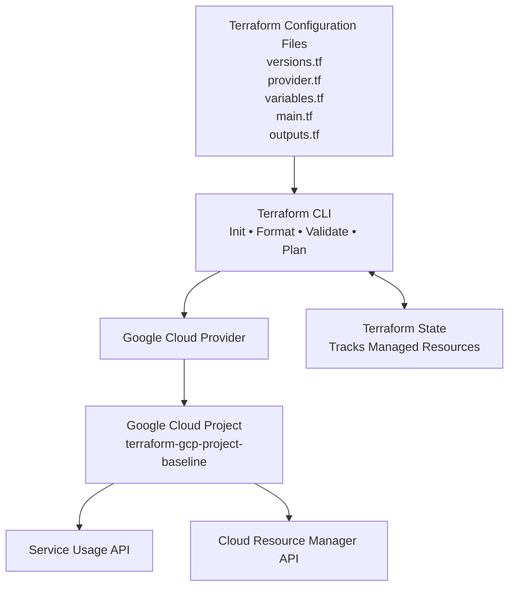

# Terraform-Managed GCP Project Baseline — Architecture

## Architecture Diagram

## Workflow

1. Define the desired configuration in Terraform files.
2. Initialize Terraform and configure the Google Cloud provider.
3. Validate the configuration and review the execution plan.
4. Terraform manages the required Google Cloud APIs.
5. Terraform state records the resources managed by the configuration.

## Managed Resources

- `serviceusage.googleapis.com`
- `cloudresourcemanager.googleapis.com`

## Project Configuration

- **Cloud provider:** Google Cloud Platform
- **Environment:** dev
- **Region:** us-central1
- **Infrastructure as Code:** Terraform
